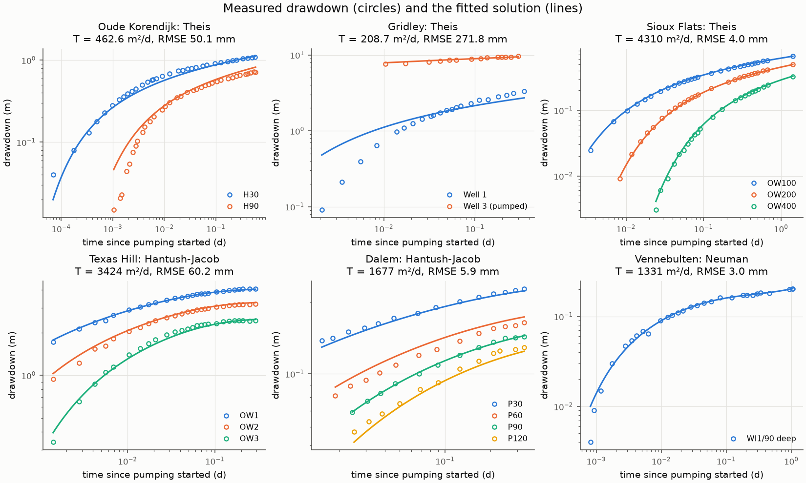

# pumptest

[](https://github.com/GeoPilot-AI/pumptest/actions/workflows/ci.yml)
[](https://geopilot-ai.github.io/pumptest/)
[](LICENSE)

**Pumping test analysis in Python.** Transmissivity, storativity, leakage,
specific yield, skin and well losses from drawdown data, by the classic
analytical solutions, with automatic fitting across any number of wells.
Validated against AQTESOLV and the textbook analyses of published tests.



- **Solutions:** Theis, Hantush-Jacob (leaky), Papadopulos-Cooper
  (large-diameter wells, with optional skin and fitted casing radius), Neuman
  (unconfined, delayed yield).
- **Straight-line methods:** Cooper-Jacob, Theis recovery, step-drawdown well losses.
- **Tests:** constant rate, recovery and any variable-rate schedule, by superposition.
- **Fitting:** least squares over every observation at once, with standard
  errors, correlations, RMSE and AICc for choosing between models.
- **Diagnostics:** the Bourdet log-derivative.
- **Example data:** seven published tests in `pumptest.datasets`, with their
  published answers.
- **Dependencies:** numpy and scipy only.

## Install

The package is not on PyPI yet. Install it from GitHub:

```
pip install git+https://github.com/GeoPilot-AI/pumptest
```

## Example

```python
from pumptest import HantushJacob, Neuman, Theis, compare, datasets, fit

test = datasets.load("oude_korendijk")  # Kruseman and de Ridder's confined test
result = fit(test, Theis())
print(result.summary())

# Which model does a leaky test call for?
for r in compare(datasets.load("texas_hill"), [Theis(), HantushJacob(), Neuman()]):
    print(f"{r.model:15} AICc {r.aicc:8.1f}  RMSE {r.rmse:.4f} m")
```

Units are never converted inside the solvers: give one consistent set (metres,
days and cubic metres per day in the bundled data) and the results come back
in it. `pumptest.units` converts field units first.

## Validation

| Test | Model | T published (m²/d) | T pumptest | Source |
|---|---|---|---|---|
| Oude Korendijk | Theis | 462.6 | 462.6 | AQTESOLV |
| Sioux Flats | Theis | 4308 | 4310 | AQTESOLV |
| Gridley | Theis | 207.3 | 208.7 | AQTESOLV |
| Texas Hill | Hantush-Jacob | 3425 | 3424 | AQTESOLV |
| Dalem | Hantush-Jacob | 1677 | 1677 | Kruseman and de Ridder |

On every one the fit is at least as good as the published parameters on the
same data. The well functions match the published type-curve tables, and the
textbook's single-well, step-drawdown and unconfined examples are reproduced.
The full page, regenerated from the code and checked by a test, is
[docs/validation.md](docs/validation.md).

## Documentation

<https://geopilot-ai.github.io/pumptest/>: getting started, tutorials,
theory, validation and the API reference.

## Development

```
pip install -e ".[dev,docs]"
python scripts/checks.py
```

Design decisions are recorded in [pm/decisions](pm/decisions/README.md);
see [Contributing](docs/contributing.md).

## Licence

MIT. Copyright 2026 Piezoline Technologies Private Limited.
