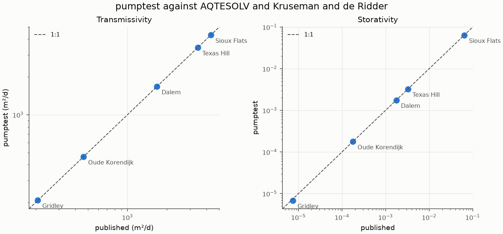
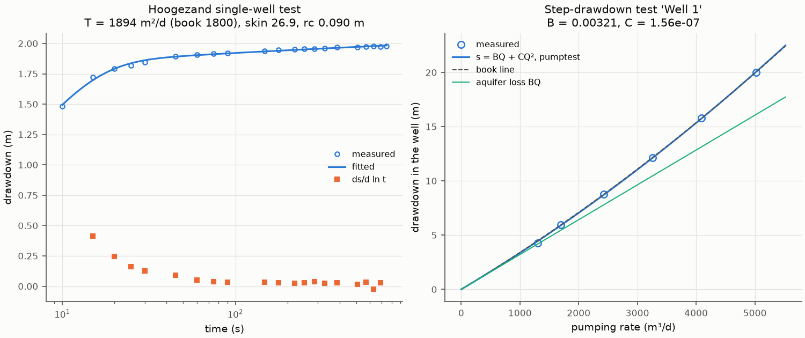

# Validation

Generated by `python scripts/validation_report.py --write`; a test fails
when this page and a fresh run disagree.

## Against AQTESOLV and published analyses

Each published test is fitted here and compared with the parameters
AQTESOLV or Kruseman and de Ridder published for it. T is in square metres
per day, c (aquitard resistance) in days. Both RMSE columns are computed
here, on the same data, in metres: the published parameters' fit and ours.

| Test | Model | Published by | T published | T here | S published | S here | c published | c here | RMSE published | RMSE here |
|---|---|---|---|---|---|---|---|---|---|---|
| Oude Korendijk | Theis | AQTESOLV | 462.6 | 462.6 | 0.0001779 | 0.0001779 |  |  | 0.05006 | 0.05006 |
| Gridley | Theis | AQTESOLV | 207.3 | 208.7 | 7.437e-06 | 6.836e-06 |  |  | 0.273 | 0.2718 |
| Sioux Flats | Theis | AQTESOLV | 4308 | 4310 | 0.06418 | 0.06414 |  |  | 0.003974 | 0.003974 |
| Texas Hill | Hantush-Jacob | AQTESOLV | 3425 | 3424 | 0.003239 | 0.00325 | 43.96 | 43.89 | 0.06025 | 0.06024 |
| Dalem | Hantush-Jacob | Kruseman and de Ridder | 1677 | 1677 | 0.001762 | 0.001762 | 331.1 | 331 | 0.005917 | 0.005917 |

Data: the TTim documentation (MIT); published values: Yang (2020), as
tabulated in the TTim notebooks. Provenance is in
`src/pumptest/datasets/data/README.md`.

## Against the published type-curve tables

Theis is checked against Abramowitz and Stegun (Table 5.1), and Hantush,
Neuman and Papadopulos-Cooper against Kruseman and de Ridder (1994),
Annexes 4.2, 5.1 and 15.1, within the tables' three-figure rounding.
See `tests/test_type_curves.py`.

## Worked examples from Kruseman and de Ridder (1994)

Their answers come from lines and type curves fitted by eye, so they are
compared within what a graph resolves.

| Example | Quantity | Published | Here | Notes |
|---|---|---|---|---|
| Well 1 step test | B (d/m2) | 0.00326 | 0.00321 | drawdown RMSE 0.1053 m published, 0.09603 m here |
| Well 1 step test | C (d2/m5) | 1.45e-07 | 1.561e-07 | same fit |
| Hoogezand single well | T, Jacob (m2/d) | 1800 | 1928 | slope 0.07 m/cycle read by eye, 0.06547 by regression |
| Hoogezand single well | T with skin, S = 4e-4 (m2/d) | not published | 1928 | skin 27.44, RMSE 0.004026 m |
| Hoogezand single well | T, full record, fitted rc (m2/d) | 1800 | 1818 | rc 0.08938 m of 0.185, skin 25.53, RMSE 0.009282 m |
| Vennebulten unconfined | T, Neuman (m2/d) | 1447 to 1616 | 1340 | RMSE 0.003033 m; Theis 0.01008, Hantush 0.005672 |
| Vennebulten unconfined | S | 0.00052 | 0.0005592 | |
| Vennebulten unconfined | Sy | 0.0049 (the book: unreasonably low) | 0.01127 | |
| Vennebulten unconfined | Kd = Kz/Kr | 0.0005444 | 0.0006934 | |

